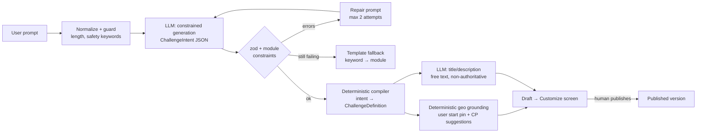

# AI: the Challenge Agent (`packages/ai`)

## Hard boundary

The LLM **never** decides GPS validity, timestamps, checkpoint reached, task completion,
scores, completion, leaderboard, auth, or verdicts. It **never counts steps, calculates calories,
or interprets mood**. Those come from sensors and deterministic code ([wellness.md](wellness.md)).
Plain-language summary: [product/what-ai-does.md](../product/what-ai-does.md). LLM output can only enter the system via:

```
ChallengeIntent → deterministic compiler → zod + engine validation → human review → publish
```

No other code path consumes LLM output. **The LLM never outputs coordinates.**

## 1. Pipeline: small semantic draft, deterministic expansion

Small on-device models are slow (roughly 10–30 tok/s on mid-range phones, to be benchmarked) and unreliable on
large nested JSON. So the model emits a **small `ChallengeIntent`** (about 150 tokens) under a
**grammar or JSON-schema constraint**, and deterministic code expands it.



### `ChallengeIntent` (LLM output)

```json
{
  "title_hint": "Pedal & Pick-up",
  "duration_min": 60,
  "participants": { "count": 5, "mode": "team", "teams": 1 },
  "activities": [{ "module": "cycling", "intensity": "easy" }],
  "tasks": [
    { "module": "cleanup", "type": "collect_items", "quantity": 10 },
    { "module": "tree_care", "type": "water_tree", "quantity": 2 }
  ],
  "checkpoints": { "count": 4, "layout": "loop|out_and_back|scatter", "target_distance_km": 6 },
  "difficulty": "medium",
  "unresolved": ["start_location"]
}
```

- `module` and `type` enums are **generated from the module registry** into the grammar, so the model cannot invent modules.
- `unresolved[]` drives follow-up UI ("Where should we start?").
- **Checkpoint geometry:** MVP places N points evenly on a loop of the target length around the user's start pin; the user drags them.
  SHOULD: snap to OSM paths and POIs (parks, benches, trees) via a server-side Overpass query. The LLM may only *name* them.

## 2. Capabilities

| Capability | Mechanism | Where |
|---|---|---|
| Generate challenge | Intent extraction + compiler | Device or server |
| Customize ("harder", "swap cycling for running") | LLM emits a **patch** (`{op, path, value}`, whitelisted paths), then recompile | Device or server |
| Adjust difficulty | Module's deterministic `difficulty()`; the LLM only picks the level | Engine |
| Suggest tasks | Pick from registry task types with params | Device or server |
| Suggest routes/checkpoints | Deterministic geometry and POIs; LLM labels only | Server for POIs |
| Variations | N intents at temperature 0.8, deduplicated | Server |
| Description, rule explanation | Free text from the compiled DSL; the deterministic rule renderer is always shown too | Either |
| Wellness recap | Narrative from **engine-computed** steps, kcal, active and phone-free minutes and mood delta, passed in as facts. The prompt forbids new numbers, and a post-check rejects output containing numbers not in the input | Device or server |
| Mindful moments | Picks `mindful.*` task types from the registry | Device or server |
| Encouragement | **Pre-generated at bundle time** (10–20 lines keyed to milestones), delivered via notification or TTS | No inference during the activity |

## 3. Provider abstraction

```ts
interface LLMProvider {
  id: string                         // "llama-rn:qwen3-1.7b-q4km" | "http:ollama:qwen3-8b" | "template"
  capabilities: {
    contextTokens: number
    structuredOutput: 'grammar' | 'json_schema' | 'none'
    streaming: boolean
    vision: boolean
    locality: 'device' | 'self_hosted' | 'none'
  }
  generate(req: {
    messages: ChatMessage[]; schema?: JSONSchema; grammar?: string
    maxTokens: number; temperature: number; stop?: string[]; signal?: AbortSignal
  }): Promise<{ text: string; json?: unknown; usage: Usage; latencyMs: number }>
}

interface ModelProfile {   // data: infra/models/profiles.json
  modelId: string; family: string; chatTemplate: string
  defaultTemperature: number; maxContext: number; promptOverrides?: Record<string, string>
}
```

| Implementation | Lives in | Covers |
|---|---|---|
| `OpenAICompatibleProvider` | `packages/ai` | Ollama, llama.cpp server, vLLM, LM Studio |
| `TemplateProvider` | `packages/ai` | No-AI deterministic fallback |
| `LlamaRnProvider` | `apps/mobile/src/features/ai` | On-device (native module) |

**Router policy:** use the on-device model if it is installed and the device meets the RAM requirement; otherwise the self-hosted
server if online; otherwise the template fallback, with the UI explaining why.

- **Prompts** are versioned files: `packages/ai/prompts/intent.v1.md`, `patch.v1.md`, `describe.v1.md`.
- Every generation records `{provider, modelId, promptVersion, schemaVersion, valid, latencyMs}`.
- **Swapping a model is a config change** (model manifest plus profile), gated by the eval suite.

## 4. Where inference happens

| Task | On-device | Self-hosted server |
|---|---|---|
| Intent extraction | ✅ primary when the model is installed (about 5–15 s, to be benchmarked) | ✅ |
| Customize patch | ✅ | ✅ |
| Variations ×3 | ❌ too slow | ✅ |
| Descriptions | ✅ short | ✅ |
| Explain rules offline | ✅ (deterministic renderer as fallback) | n/a |
| Encouragement lines | ❌ (static fallback library) | ✅ at bundle time |
| Photo plausibility (vision) | ❌ | COULD, advisory flag only |

## 5. Constraints

- **Size:** 1–2B parameters at Q4_K_M is about 0.7–1.2 GB. Comfortable on 6 GB RAM devices; use a 0.6–1B tier for 4 GB devices.
- **Quantization:** Q4_K_M on device; Q4/Q5/Q8 on the server.
- **Context:** prompts under 2k tokens; 4k context on device to limit KV-cache memory.
- **Battery:** inference is bursty, and none runs during an active session except an on-demand "Explain rules".
- **Privacy:** on-device prompts never leave the phone. Server prompts are kept 30 days and the builder UI says so.
- **App size:** the model is **not bundled**. It's an opt-in download (Wi-Fi by default) verified by SHA-256 from `GET /v1/ai/models`.

## 6. Recommended models (benchmark in week 1)

| Tier | Model | Runtime | Size | Notes |
|---|---|---|---|---|
| On-device primary | **Qwen3-1.7B Instruct Q4_K_M** | llama.rn | ~1.1 GB | Apache-2.0, good JSON |
| On-device low-RAM | Qwen3-0.6B / Gemma 3 1B Q4 | llama.rn | 0.4–0.8 GB | Intent only |
| On-device alternative | Llama 3.2 3B Instruct Q4 | llama.rn | ~2 GB | Community license |
| Server | **Qwen3-8B** (or 4B on CPU) Q4/Q5 | Ollama (dev/demo); llama.cpp server or vLLM (prod) | 2.5–5 GB | Structured outputs |
| Vision (COULD) | Qwen2.5-VL-3B / Gemma 3 4B | Ollama | ~3 GB | Advisory only |

Check for newer releases and confirm licenses before committing to a model. An Apache-2.0 model is the cleanest default for an OSS repo.

## 7. Evaluation

`packages/ai/evals/`: 50+ prompts (varied phrasing, Bengali/Hindi/English mixes, adversarial
"give me 1000 points"). Metrics: schema-valid rate, enum adherence, constraint adherence, latency.
Gate: **≥ 90 % valid intents** before a model or prompt change ships.

## 8. AI Module Builder (custom activities, ADR-027)

`packages/ai/src/module/*`. Pipeline: deterministic pre-safety on the prompt (any language; unsafe → refused before any
model runs) → English-only check → constrained `ModuleIntent` (enums from the Module DSL, labels and safety concerns only;
**no numbers, points, thresholds, ids or `sensor` verification**) → repair loop (≤ 2) → keyword-template fallback →
deterministic `compileModuleIntent` (all numbers from fixed tables) → engine `compileModule` → final deterministic safety
(monotonic: concerns only add restrictions) → optional description text (rejected if it has digits, links or unsafe
words). Eval: `evals/modules.jsonl` (48 prompts incl. Bengali, Hindi, code-mixed and adversarial) via `evals/run-modules.ts`;
gates: ≥ 90 % adherence and valid modules, **100 % unsafe handled**, ≤ 5 % false blocks. The Challenge Agent itself only
composes built-in modules (data-module challenges come from `challengeFromModule`, which keeps the points budget).

