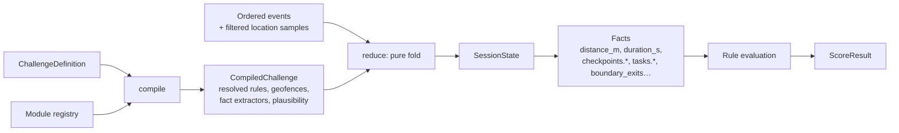

# Challenge DSL and rules engine (`packages/engine`)

The engine is the **only** place scoring, completion, and checkpoint/task logic lives.
It is **pure and deterministic**, with no `Date.now()`, randomness or I/O, and the same build runs on the
device (provisional) and the server (authoritative).

## 1. Challenge DSL: `ChallengeDefinition` v1

Defined as zod in `@trina/contracts` (`challenge-definition.ts`).

```json
{
  "schemaVersion": "1.0",
  "meta": { "title": "...", "description": "...", "tags": [], "difficulty": "easy|medium|hard",
            "visibility": "public|unlisted|private", "language": "en" },
  "modules": [{ "id": "cycling", "version": 1, "params": { "minDistanceM": 4000 } },
              { "id": "cleanup", "version": 1, "params": {} }],
  "mode": "individual|team",
  "participants": { "min": 1, "max": 5, "teams": { "count": 1, "sizeMax": 5 } },
  "timing": { "durationMin": 60, "window": { "opensAt": "ISO", "closesAt": "ISO" },
              "startGraceMin": 10, "daylightOnly": true },
  "area": {
    "startZone": { "type": "circle", "center": [88.36, 22.57], "radiusM": 75 },
    "boundary":  { "type": "polygon", "coordinates": [[[88.36, 22.57], "..."]], "graceM": 50 },
    "endZone":   { "type": "circle", "center": [88.36, 22.57], "radiusM": 75 }
  },
  "route": { "type": "ordered|unordered|free", "checkpointIds": ["cp1", "cp2", "cp3", "cp4"] },
  "checkpoints": [{ "id": "cp1", "name": "Lake gate",
                    "geometry": { "type": "circle", "center": [88.36, 22.57], "radiusM": 30 },
                    "required": true, "dwellSec": 5, "maxAccuracyM": 40 }],
  "tasks": [{ "id": "t1", "type": "cleanup.collect_items", "params": { "quantity": 10 },
              "location": { "kind": "checkpoint|anywhere|in_boundary", "ref": "cp2" },
              "evidence": [{ "kind": "photo", "count": 1, "hint": "Full bag of litter" }],
              "required": true, "scope": "individual|team" }],
  "scoring": {
    "rules": [
      { "id": "r1", "kind": "per_checkpoint", "points": 25 },
      { "id": "r2", "kind": "per_task", "task": "t1", "points": 50 },
      { "id": "r3", "kind": "metric_rate", "metric": "distance_m", "pointsPer": 1, "per": 100, "cap": 50 }
    ],
    "bonuses": [{ "id": "b1", "kind": "condition",
                  "when": { "all": [ { "fact": "duration_s", "op": "<=", "value": 3600 },
                                     { "fact": "completed", "op": "==", "value": true } ] },
                  "points": 50 }],
    "penalties": [{ "id": "p1", "kind": "per_occurrence", "fact": "boundary_exits",
                    "points": -10, "graceCount": 1 }],
    "teamAggregation": "sum|avg|min"
  },
  "completion": {
    "all": [ { "fact": "checkpoints.required_reached", "op": "==", "value": "ALL" },
             { "fact": "tasks.required_done", "op": "==", "value": "ALL" } ],
    "endZoneRequired": true
  },
  "safety": { "maxSpeedMps": 15, "noSpeedRewards": true }
}
```

### Rules
- Coordinates use GeoJSON `[lng, lat]` order. Units: metres, seconds, integer points.
- Conditions use a **closed AST**: `{fact, op, value}` with `op ∈ == != < <= > >=`, combined by `all`, `any`, `not`.
  **No string expressions and no `eval`.**
- Validation (zod plus engine `compile`) enforces: ids unique; references resolve; radii 10–500 m;
  polygon ≤ 200 vertices and not self-intersecting; duration 5–480 min; tasks belong to declared
  modules; scoring kinds known; max possible score computed and ≤ 10,000.
- Definitions are **immutable per version** (`challenge_versions`). Participants are pinned.

## 2. Engine pipeline



### Public API (planned)

```ts
compile(def: ChallengeDefinition, registry: ModuleRegistry): CompileResult      // {ok, compiled, errors, warnings, maxScore}
initialState(compiled): SessionState
reduce(compiled, state, event): SessionState                                    // pure
facts(compiled, state): Facts
evaluate(compiled, state): ScoreResult                                           // {total, breakdown[], completed, engineVersion, inputsHash}
geo: { haversineM, pointInCircle, pointInPolygon, bearingDeg, simplifyLine }
wellness(compiled, state, { weightKg? }): WellnessResult   // steps, cadence, activeMinutes, phoneFreeMinutes, kcalEstimate (MET table), moodBefore/After
```

`wellness()` is **separate from `evaluate()`**: wellness never feeds scoring. See [wellness.md](wellness.md).

- **Device:** reduces incrementally on each new event and renders `evaluate()` as the provisional score.
- **Server:** reduces over the **validated** event set (invalid samples excluded) and stores `ScoreResult`.
- `ScoreResult.breakdown[]` items: `{ruleId, label, points, status: 'awarded'|'invalidated'|'not_met', reason?}`.
- **Determinism:** integer metres and points, fixed rounding, events sorted by `seq`, and `engineVersion` stamped on every result.
- **Team score:** member `ScoreResult`s, plus team-scoped tasks counted across members, aggregated by `teamAggregation`.

## 3. Module plugin contract

```ts
interface ChallengeModule {
  id: string                 // 'cleanup'
  version: number
  displayName: string
  icon: string
  paramsSchema: ZodSchema
  taskTypes: TaskTypeDef[]   // { id: 'cleanup.collect_items', paramsSchema, defaultEvidence, completion }
  eventHandlers?: Partial<Record<EventType, ModuleReducer>>
  factExtractors: FactExtractor[]
  defaultRules(params): Rule[]
  difficulty(params, level: 'easy'|'medium'|'hard'): params
  plausibility: { maxSpeedMps: number; minTaskSeconds?: number }
  validators?: SessionValidator[]   // server-side extra checks → flags
  aiHints: { description: string; examples: string[] }  // used in prompts and grammar enums
}
```

The registry (`modules/index.ts`) is the single list. It feeds:
`GET /v1/modules` → the UI task editor → **AI grammar enums** → server seed of `challenge_modules`.

To add one, see [guides/adding-a-module.md](../guides/adding-a-module.md).

## 4. Predefined modules

| Module | Required inputs | Location/route | Typical tasks | Evidence | Scoring | Completion | Bonus | MVP |
|---|---|---|---|---|---|---|---|---|
| `walking` | duration, target distance | free or route | reach checkpoints | optional | distance rate, checkpoints | distance ≥ target or all CPs | under time | ✅ MUST |
| `running` | distance, optional time target | route | splits | none | checkpoints, completion | finish in end zone | pace target (no road speed) | ✅ MUST (walking variant) |
| `cycling` | distance, route | ordered | checkpoints | none | checkpoints, capped distance | all CPs | none (safety) | ✅ MUST |
| `cleanup` | quantity, area | boundary or CP | `collect_items` | photo | per task | task done | extra bag | ✅ MUST |
| `tree_care` | tree count | tree CPs | `water_tree` | photo per tree | per tree | all trees | none | ✅ MUST |
| `scavenger` | clues | unordered CPs | `find_spot` | photo | per find | N of M | first finisher | SHOULD |
| `fitness` | exercise list | start zone | `do_reps` (self-report) | optional | per set | all sets | none | SHOULD |
| `mindful` | none | anywhere / checkpoint | `pause`, `notice`, `breathe` (self-report) | none | 0 or small fixed points (not farmable) | n/a | none | SHOULD |
| `shopping_walk` | public stops | route | `visit_stop` | optional photo | per stop | all stops | walk-only | COULD |
| `football` | targetMinutes | play area | `refereed`, `clean_sheet` (confirmation) | none | time in zone + confirmed goals/assists | manual finish | n/a | ✅ data module |
| `cricket` | overs, targetMinutes | play area | `team_photo` (photo), `scored_match` (confirmation) | photo | time in zone + confirmed overs/catches | manual finish | n/a | ✅ data module |

Football and cricket are **official data modules** (ADR-023, `packages/engine/src/modules/data/team-sports.ts`): time at the
ground is measured; balls, overs, catches, goals and assists are **counters** that earn points only when another player
confirms them with a signed QR handshake (ADR-026). The old `OrganizerConfirmation` event is deprecated: engine v2 treats it
as self-report because the participant writes it into their own chain.

## 4b. Data modules, milestones and engine v2

- **Data modules** (`compileModule`, `modules/declarative.ts`): a `ModuleDefinition` (`module/1.0`, `@trina/contracts`) compiles into
  an ordinary `ModuleDef` from closed primitives (movement profile, counters, task types, weights). Built-in TS modules also have
  a DSL **descriptor** that passes the same schema. `registry.with(extra)` adds runtime modules; built-in/official ids can't be shadowed.
- **Compile rules for data modules:** custom modules must be pinned by `definitionHash`; max points per minute **8 / 12 / 15**
  (easy / medium / hard); self-reported counters never earn points (`per_count` on a self-report fact is an error); no plain
  duration rewards. `challengeFromModule()` builds a deterministic challenge within the budget.
- **Challenge DSL 1.1 (additive):** `ModuleRef.definitionHash`, scoring rule `per_count {fact, pointsPer, per, cap}`, metric `zone_dwell_s`.
- **New facts:** `zone_dwell_s`, `phone_free_minutes`, `start_local_minute`, `offline_s`, `photo_proofs`, `<module>.<counter>`,
  `<module>.<counter>.confirmed`, `<module>.<task>.done_count`; each with a verification level (`compiled.factLevels`).
- **Milestones** (`milestones.ts`, pure): `summarizeSession` → `evaluateMilestones(catalog, summaries, {mode})` over
  session/day/week/month/lifetime windows (sum, max, sessions, days, streak_days with rest days and `samePlace`, distinct_places);
  `coPresence` (server only); `progression` (XP, rank points, rank, weekly bonus/penalty). Day key = local date of (start − 4 h).
- **Quests** (`quests.ts`): `buildQuestDefinition(spec, startFix)` (same hash on phone and server), `pickDailyQuests(user, day)`.
- `ENGINE_VERSION` = **2**. Full design: [milestones-and-custom-modules.md](milestones-and-custom-modules.md).

## 5. Demo challenge: Green Sprint 60

See [delivery/mvp-scope.md](../delivery/mvp-scope.md#demo-challenge-green-sprint-60).
