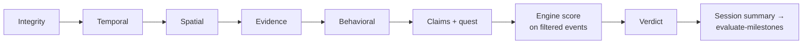

# Evidence and validation (anti-cheat)

Goal: **flag suspicious activity honestly.** We never claim perfect fraud detection, and EXIF is
**never** trusted on its own.

## 1. Capture (device)

1. **In-app camera only** for required evidence; there is no gallery picker.
2. On shutter: take the best fix (at most 10 s old, or wait up to 5 s), `wallNow`, `monoNow`, `taskId`, `checkpointId`.
3. Compress (1600 px, JPEG 0.8), then compute **SHA-256**, then save to `documentDirectory/evidence/<sessionId>/<evidenceId>.jpg`.
4. In **one transaction**, insert the `evidence` row and an `EvidenceCaptured` event
   `{evidenceId, taskId, checkpointId, sha256, bytes, fix{lat,lng,acc,ts}, monoMs}`.
   This binds the photo hash into the hash chain.
5. Upload later (see [offline-and-sync.md](offline-and-sync.md#8-photos)).

## 2. Server handling of uploads

- Magic-byte check (JPEG/WebP only), ≤ 5 MB, SHA-256 must equal the hash in the event.
- `sharp` re-encode produces the served derivative (EXIF stripped, polyglots neutralized). The original is kept private for review.
- pHash computed for duplicate detection.
- Private bucket, randomized keys, short-lived signed URLs after an authorization check.

## 3. Validation pipeline (deterministic, ordered)

| Stage | Checks | Example flags (severity) |
|---|---|---|
| **Integrity** | Device owned by user; seq complete; hash chain valid; definition version exists; signature valid (SHOULD) | `SEQ_GAP` (warn), `CHAIN_BROKEN` (critical), `DUP_ID_DIFF_HASH` (critical) |
| **Temporal** | Within window ± grace (clock offset from download); wall vs mono drift (> 2 % or > 60 s); no event later than server receive time; GPS fix time vs device time | `CLOCK_DRIFT` (warn), `FUTURE_EVENT` (critical), `OUTSIDE_WINDOW` (critical) |
| **Spatial** | Accuracy filter; speed and jump; mocked fixes; **recompute** checkpoint reach and boundary exits from samples | `MOCK_LOCATION` (critical), `LOCATION_JUMP` (warn ×n), `CP_UNCONFIRMED` (item invalidated) |
| **Evidence** | Uploaded hash equals event hash; capture time inside session; location within task radius + accuracy; correct sequence (e.g. after CP reached); pHash near-duplicate across own and other sessions; EXIF as a weak signal only | `EVIDENCE_HASH_MISMATCH` (critical), `EVIDENCE_DUPLICATE` (warn/critical), `EVIDENCE_OFF_LOCATION` (item invalidated), `EVIDENCE_MISSING` (item invalidated) |
| **Behavioral** | Task faster than module `minTaskSeconds`; implausible totals; module `validators`; **step cadence vs GPS** for foot modules (skipped if no step data) | `TOO_FAST` (warn), `STEPS_GPS_MISMATCH` (warn), `CADENCE_IMPLAUSIBLE` (warn) |
| **Claims** (pipeline v2) | Signed confirmations: both sides present, Ed25519 signature against the confirmer's registered device key, same claims, same challenge; confirmer co-present (zone overlap ≥ 10 min); organizer role only from the creator; ≤ 30 per confirmer per day; reciprocal rings; self-reported counts faster than `maxPerMinute` or above `maxPerSession` | `CONFIRM_PENDING` (info), `CONFIRM_UNMATCHED` (warn), `CONFIRM_SELF` (critical), `CONFIRM_SIGNATURE_INVALID` (critical), `CONFIRMER_NOT_COPRESENT` (warn, falls back to self-report), `CONFIRM_ROLE_INVALID` (warn), `CONFIRM_RATE` (warn), `CONFIRM_RECIPROCAL` (warn, kept), `COUNT_IMPLAUSIBLE` (warn, clipped) |
| **Offline quest** | Quest definition rebuilt from the template and compared; `ConnectivityChanged` present; authenticated request minutes from the device inside the quest removed from offline time | `QUEST_DEFINITION_MISMATCH` (critical), `OFFLINE_UNRECORDED` (warn), `ONLINE_DURING_QUEST` (warn) |
| **Party** (pipeline v3) | Invite signature + host's registered key; definition rebuilt from the invite; each `PeerSighting`: signature, same party, not self, registered key, replies to this phone's nonce, the other side recorded it, both times agree (≤ 2 min), both GPS fixes ≤ 75 m + accuracy; **chain entanglement**: what teammates recorded about this chain must match it. A party session's first validation re-validates its teammates once | `PARTY_DEFINITION_MISMATCH` / `PARTY_INVITE_INVALID` / `PARTY_HOST_KEY_UNKNOWN` / `PARTY_INVITE_CONFLICT` / `PARTY_ROLE_INVALID` (critical), `PARTY_FULL` (warn), `SIGHTING_SIG_INVALID` / `SIGHTING_WRONG_PARTY` / `SIGHTING_SELF` / `SIGHTING_KEY_UNKNOWN` (critical), `SIGHTING_REPLAY` / `SIGHTING_UNMATCHED` / `SIGHTING_CLOCK` / `SIGHTING_DISTANT` (warn), `SIGHTING_PENDING` (info), **`CHAIN_FORK` (critical)** |
| **Quest length** | Daily Quest longer than the player's rank cap (ADR-032) | `QUEST_ADAPT_OUT_OF_BOUNDS` (warn) |
| **Score** | Engine over filtered events | n/a |

## 4. Verdict rules

| Condition | Verdict | Leaderboard |
|---|---|---|
| Any critical flag | `needs_review` | Hidden ("Pending review") |
| Warnings only | `verified_with_notes` | Shown with a note badge |
| No flags | `verified` | Shown |
| Admin decision | `verified` or `rejected` | According to the decision |

- **Invalidated items** (an unconfirmed checkpoint, off-location photo) score 0 with a reason; the
  rest of the session still counts.
- UI language is neutral: "We couldn't confirm checkpoint 3 (weak GPS). It wasn't counted."
- Re-validation is possible (new `validation_runs` row) when the engine or pipeline version changes.

## 5. Realistic MVP anti-cheat

**We do:** mock-location detection (Android), speed and jump plausibility, server recomputation from raw
samples, hash-chained log, monotonic vs wall clock, server time anchoring, in-app camera only,
photo-hash binding, pHash duplicates, flag queue with human review, organizer confirmation for sports.

**We do not claim to stop:** rooted devices with hooked GPS, GPS spoofing hardware, someone carrying
another person's phone, or staged photos. The leaderboard copy says "Verified by automated checks".

## 6. Retention

Evidence is kept for 90 days, then objects are deleted (the user can delete earlier). Flags and verdicts are kept for the life of the session.
