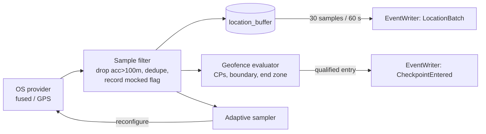

# Location architecture

## 1. Permissions

- **While-in-use only.** Never request "Always".
- Android: a foreground service of type `location` with a persistent notification (also the lock-screen UI). Needs notification permission on Android 13+.
- iOS: while-in-use with the `location` background mode, started from the foreground (blue pill indicator).
- Explain before asking (UX screen 12). If denied, deep link to settings.

## 2. Tracking pipeline

Tracking **starts only at `SessionStarted`** (inside the start zone) and **stops at `SessionCompleted` or `SessionAbandoned`**.

## 3. Adaptive sampling (battery)

| Situation | Accuracy | Interval | Distance filter |
|---|---|---|---|
| Far from next CP (> 300 m) | Balanced | 10 s | 15 m |
| Near a CP (< 300 m) | High | 3 s | 5 m |
| Stationary (≈0 speed for 2 min) | Balanced | 30 s | 20 m |
| Dwell modules (football, cricket) | Balanced | 30 s | 25 m |

Target battery cost: **≤ 10 % per hour** on a mid-range Android device.

## 4. Geofence rules (in `@trina/engine` geo, shared by device and server)

- **Inside a circle:** `haversine(center, fix) ≤ radius + min(fix.accuracy, 25)` **and** `fix.accuracy ≤ maxAccuracyM`.
- **Checkpoint reached:** inside for `dwellSec`, with at least 2 qualifying fixes.
- **Boundary exit:** outside by more than `graceM` for at least 30 s (hysteresis); re-entry is symmetric.
- **Start zone:** inside with accuracy ≤ 50 m; the UI waits up to 30 s for a better fix.
- The server **recomputes** reach and exits from the raw samples. Device `CheckpointEntered` events are hints only.

## 5. Poor GPS, loss, jumps, spoofing

| Condition | Handling |
|---|---|
| Accuracy > 100 m | Dropped from tracking (count kept) |
| No fix for 30 s | `GpsSignalLost` event; UI shows "Weak GPS, keep going". Distance across the gap is capped at `maxSpeed × gap` |
| Implied speed > module `maxSpeedMps` (walk 4, run 7, cycle 15) | Sample excluded from distance; `LOCATION_JUMP` flag |
| Android `mocked` fix | `MockLocationDetected` event; server flag `MOCK_LOCATION` (critical) |
| Borderline at a CP | "I'm here" creates `CheckpointManualConfirm` (low confidence); the server decides |

## 6. Privacy: what is stored, and for how long

| Data | Precision | Where | Retention |
|---|---|---|---|
| Discover query location | Rounded to about 1 km on the client | Not persisted | n/a |
| Challenge start zone and checkpoints | Exact (public places chosen by the creator) | Postgres | Life of the challenge |
| User location **before Start** | **Never recorded** | n/a | n/a |
| Start validation | First fix inside the zone + accuracy | Postgres (in `SessionStarted`) | With session |
| Raw track samples | Exact | Device until acked + 7 days; Postgres **30 days** | Then simplified (Douglas–Peucker 20 m), **clipped to boundary**, stored in `session_tracks`; raw deleted |
| Evidence location | Exact | Postgres | 90 days (with the photo) |
| Leaderboard | **No location** | n/a | n/a |
| Logs | **No coordinates** ever | n/a | n/a |

- Home locations are never captured because tracking begins inside a creator-defined, public start zone.
- Creators get a warning if a start zone looks residential (SHOULD: OSM landuse check).
- Users can delete any session's track from History. The score is kept and marked "track deleted by user".
