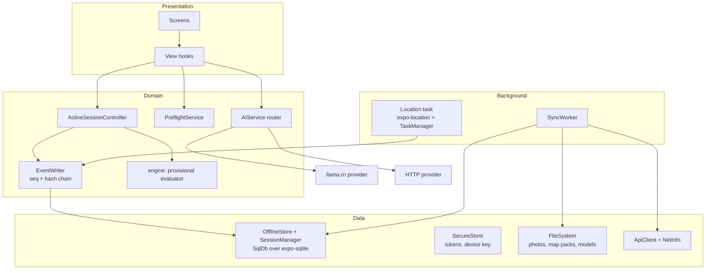

# Mobile architecture (`apps/mobile`)

## Layers



**Rule:** UI components never call the API to mutate state. They call domain services, which write
to SQLite and enqueue to the outbox. The exceptions are online-only calls: auth, discover,
leaderboard and server-side AI.

## Library choices

| Concern | Choice | Notes / trade-off |
|---|---|---|
| Framework | Expo SDK (**dev builds**, prebuild) + TS strict | Native modules allowed; not Expo Go |
| Navigation | React Navigation (native stack + bottom tabs) | Activity Mode is its own stack |
| Local DB | `expo-sqlite` (WAL) behind the `SqlDb` interface; plain SQL migrations (ADR-020) | The same core runs on `node:sqlite` in tests |
| UI state | Zustand | Ephemeral only |
| Server reads | Direct `ApiClient` calls on online-only screens; leaderboard cached in SQLite | Fewer dependencies |
| Location | `expo-location` + `expo-task-manager` | Android foreground service; iOS background mode with while-in-use |
| Camera | `expo-camera` (`CameraView`) + `expo-image-manipulator` (1600 px JPEG) | In-app only; no gallery |
| Maps | Tile-free SVG route map + compass (`components/RouteMap.tsx`, ADR-021) | MapLibre optional later |
| Secure storage | `expo-secure-store` | Tokens, device key. Never AsyncStorage |
| Crypto | `@noble/hashes` (pure-JS SHA-256, same as server) | Hash chain, evidence hash |
| On-device LLM | `llama.rn` | Opt-in model download about 1 GB |
| Connectivity | `@react-native-community/netinfo` | The actual request result is the truth |
| Background tasks | `expo-background-task` | Opportunistic sync |
| Tests | Vitest on `node:sqlite` + e2e against the real server; Maestro flows are a TODO | GPX replay on emulator for manual GPS tests |

## Folder structure

```
apps/mobile/src
  app/            navigation (RootNavigator, AuthStack, Tabs, ActivityStack)
  screens/        one folder per screen (25, see docs/product/ux-screens.md)
  components/     shared UI (SyncPill, BigButton, ChecklistItem, CompassArrow…)
  features/
    session/      ActiveSessionController, EventWriter, provisional engine adapter
    location/     location task, sample filter, adaptive sampler, geofence evaluator
    evidence/     capture, compress, hash, storage
    sync/         SyncWorker, push/pull/upload, backoff, outbox processor
    preflight/    checks
    ai/           AIService router, LlamaRnProvider, model download manager
    challenges/   bundle download, map pack download
    auth/         session, token refresh
  data/
    db/           drizzle schema + migrations (see docs/data/sqlite-schema.md)
    repos/        repositories
  platform/       api client, secure store, file system, net, clock (wall + mono)
  theme/          high-contrast outdoor theme
```

## Key flows (device)

- **Writing an event:** a single SQLite transaction reads the session's `last_seq` and `chain_head`,
  computes the hash, inserts the event, and updates the session. The UI confirms only after commit.
- **Crash resume:** Splash finds an `in_progress` session, rebuilds state by folding its events
  (or from the cached `provisional_state_json`), and opens Activity Mode.
- **Clock:** `platform/clock` exposes `wallNow()` and `monoNow()` (elapsed realtime). Sessions store
  `boot_id` and the server offset captured at bundle download.

See also: [offline-and-sync.md](offline-and-sync.md), [location.md](location.md), [ai.md](ai.md).
