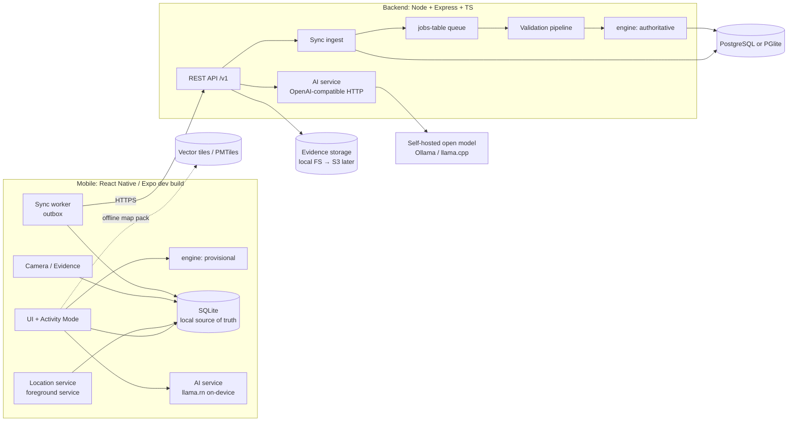

# Architecture overview

## High-level

**Key idea:** the **same `@trina/engine` package runs on device and server.** The device computes a
provisional score offline for instant feedback; the server recomputes from validated, filtered
events, and only that result is authoritative.

## Components

| Component | Responsibility | Authoritative for |
|---|---|---|
| `@trina/contracts` | zod schemas: Challenge DSL, events, sync protocol, API DTOs | Data shapes (both sides) |
| `@trina/engine` | Pure deterministic compiler and evaluator, module registry | Scoring logic (code) |
| `@trina/ai` | Provider interface, prompts, intent schema, intent→DSL compiler | Nothing (advisory) |
| `apps/mobile` | UX, local persistence, tracking, capture, sync client | The raw record until acknowledged |
| `apps/server` (API) | Auth, challenges, sync ingest, evidence, leaderboards | Identity, final scores, verdicts |
| `apps/server` (worker) | Validation pipeline, retention jobs, leaderboard rebuild | Flags and verdicts |
| PostgreSQL + PostGIS | Persistent server data, geo queries | Everything final |
| Object storage | Evidence photos (private bucket) | Photo binaries |
| LLM runtime | Inference | Nothing |

## Deployment (MVP)

One `docker-compose` (see [infra/README.md](../../infra/README.md)) containing:
`postgres+postgis`, `minio`, `api`, `worker` (same image, different entrypoint) and `ollama`.
A single VM (about 4 vCPU / 16 GB) runs everything, including a 4–8B Q4 model on CPU. That is
slow but acceptable for the demo.

## Where to go next

- [mobile.md](mobile.md), [backend.md](backend.md), [challenge-engine.md](challenge-engine.md),
  [ai.md](ai.md), [offline-and-sync.md](offline-and-sync.md), [location.md](location.md),
  [evidence-validation.md](evidence-validation.md), [security.md](security.md)
