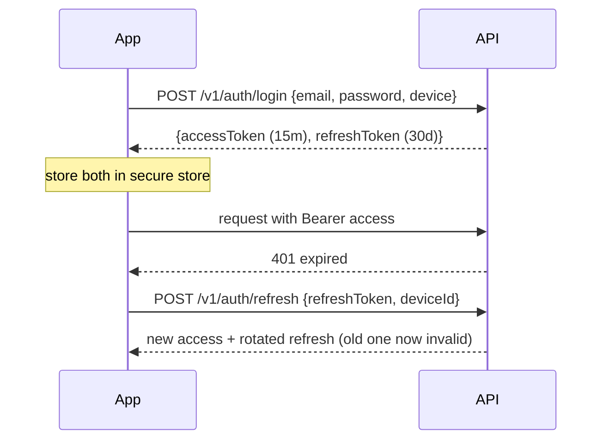

# Authentication and security

## 1. Authentication (MVP, deliberately simple)

| Element | Design |
|---|---|
| Registration and login | Email + password (min 10 chars). **Argon2id** (m=19 MiB, t=2, p=1). Email verification is SHOULD |
| Access token | JWT, **15 min**, claims `sub`, `role`, `did` (device id), `sid`. HS256 with `kid` rotation (EdDSA later) |
| Refresh token | Opaque 256-bit random, **stored hashed**, 30-day sliding expiry, **rotation with reuse detection** (reuse revokes the whole family) |
| Device storage | `expo-secure-store` (Keychain / Keystore). Never AsyncStorage or SQLite |
| Device | `deviceId` UUID created at install, registered on login (platform, app version; SHOULD: public key) |
| Logout | Revoke the device's refresh family and clear secure store. **If unsynced data exists:** warn and offer "Sync first" |
| Devices screen | List and revoke sessions |
| Roles | `user`, `admin`. "Creator" is **ownership** (`challenges.creator_id`), not a role |
| Long offline | Recording never needs a token. If the refresh token expired at sync time, the user signs in again and the queue is preserved. A **different** user signing in leaves the old queue quarantined, never uploaded under the wrong account |

## 2. Authorization

- Middleware sets `req.user`. **Every** repository query is scoped by owner, participant or admin (no IDOR).
- Challenge drafts are visible to the creator only. Sessions are visible to the owner, a limited view to the creator, and full view to admins (audited).
- Evidence binaries are served only through signed URLs after the same checks.

## 3. Threats and controls

| Area | Control |
|---|---|
| Input validation | zod on every body, query and param; JSON limit 1 MB, push limit 512 KB; geometry sanity (radius bounds, ≤ 200 vertices, no self-intersection) |
| SQL injection | Parameterized queries only (`$1…` placeholders via the `Db` interface); no string-built SQL from input |
| Rate limiting | Login 5/min per IP+email; register 3/h per IP; AI 10/min and 100/day per user; sync 60/min per device; uploads 30/min |
| Uploads | JPEG/WebP via **magic bytes**, ≤ 5 MB, `sharp` re-encode, private bucket, random keys, signed URLs (5 min) |
| Replay / duplicates | Event id PK; evidence id + hash; `Idempotency-Key` table (24 h); short-lived access tokens; refresh rotation |
| Offline tampering | Hash chain, monotonic clock, server recomputation from raw samples. SHOULD: Keystore-signed completion manifest. COULD: Play Integrity / App Attest |
| Location data | TLS only, retention limits, never logged, admin track access audited |
| Photos | Private by default; owner, creator (review) and admins only. Camera hint "avoid photographing people". Face blur is COULD |
| Wellness data | Weight is device-only; mood syncs only on opt-in; org reports aggregate only with ≥ 5 people; "not medical advice" copy. See [wellness.md](wellness.md#5-privacy-and-safety) |
| PII | Minimal (email, display name). Account deletion purges within 30 days. Data export SHOULD |
| Data at rest (device) | App sandbox + OS encryption; SQLCipher SHOULD |
| Transport | HTTPS + HSTS. No cert pinning in MVP (operational risk) |
| Secrets | Env vars / secrets manager; only `.env.example` committed |
| AI | Output is schema-constrained and human-reviewed, which contains prompt-injection impact. Deterministic blocklist on user-generated text |
| Safety | Safety acknowledgement at join, no speed rewards, daylight default, creator guidelines, takedown |

## 4. Security testing

IDOR test suite, rate-limit tests, upload fuzzing (bad magic bytes, oversized, polyglot), dependency
scanning (Dependabot), secret scanning, OWASP API Top-10 checklist before the demo.
