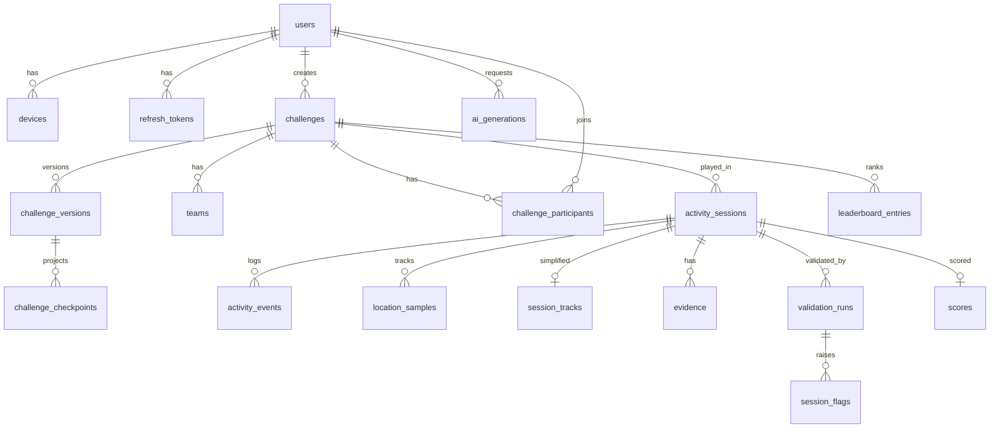

# PostgreSQL schema (server, authoritative)

> **Migration 3 (2026-10-11)** adds the milestone, progression, data-module, confirmation, moderation, offline-quest and guild
> tables below ([design](../architecture/milestones-and-custom-modules.md)), plus `challenges.guild_id` and the Daily Quest anchor rows.

> **Implementation notes (ADR-019/020):** the MVP runs on PostgreSQL 16 **or embedded PGlite** with no extensions:
> geo uses `lng/lat DOUBLE PRECISION` columns (not PostGIS); emails are lower-cased `TEXT`; raw GPS lives in
> `LocationBatch` event payloads (redacted after 30 days) instead of a separate `location_samples` table;
> extra tables: `jobs` (queue), `user_changes` (pull feed), `schema_migrations`; `activity_sessions.mood_json` (opt-in mood).
> Source of truth: `apps/server/src/platform/migrations.ts`.

- PostgreSQL 16 (PostGIS optional later).
- All ids are `uuid`. **Client-generated** ids (UUIDv7): devices, activity sessions, events, evidence, sync batches.
- Every table has `created_at timestamptz not null default now()`; mutable tables also have `updated_at`.
- Migrations live in `apps/server/src/platform/migrations.ts` (plain SQL, ADR-020).

## Identity

| Table | Columns | Constraints / notes |
|---|---|---|
| `users` | id, email citext, password_hash, display_name, role (`user`\|`admin`), email_verified_at, deleted_at | UNIQUE(email). Soft delete, then purge job |
| `devices` | id (client), user_id, platform, os_version, app_version, public_key NULL, last_seen_at, revoked_at | FK users |
| `refresh_tokens` | id, user_id, device_id, family_id, token_hash, expires_at, rotated_at, revoked_at, revoked_reason | UNIQUE(token_hash); index(family_id) |
| `idempotency_keys` | user_id, key, route, request_hash, response_status, response_body jsonb, expires_at | PK(user_id, key); TTL 24 h |

## Challenges

| Table | Columns | Constraints / notes |
|---|---|---|
| `challenge_modules` | id text PK, version int, display_name, params_schema jsonb, enabled bool | Seeded from the engine registry at deploy |
| `challenge_templates` | id, title, module_ids text[], definition jsonb, is_official, created_by | Gallery |
| `challenges` | id, creator_id, template_id NULL, status (`draft`\|`published`\|`cancelled`\|`archived`), visibility, title, current_version int, start_point geography(Point,4326), area geography(Polygon,4326) NULL, opens_at, closes_at, difficulty, module_ids text[], max_participants | GIST(start_point); index(status, opens_at) |
| `challenge_versions` | challenge_id, version, definition jsonb, definition_hash, engine_min_version, created_by, ai_generation_id NULL | PK(challenge_id, version). **Immutable** (no UPDATE). Source of truth for rules, tasks and scoring |
| `challenge_checkpoints` | challenge_id, version, checkpoint_id text, ord, geom geography(Point), radius_m | **Projection** of the definition for geo queries and admin maps |
| `teams` | id, challenge_id, name, created_by, max_size | UNIQUE(challenge_id, name) |
| `challenge_participants` | challenge_id, user_id, team_id NULL, joined_version, status (`joined`\|`withdrawn`), joined_at | PK(challenge_id, user_id) |

**Design choice:** rules, tasks and scoring live in **versioned jsonb** validated by zod and the engine,
not in normalized tables. Only queryable fields are projected into columns. See ADR-007.

## Activity

| Table | Columns | Constraints / notes |
|---|---|---|
| `activity_sessions` | id (client), challenge_id, challenge_version, user_id, device_id, team_id NULL, status (`in_progress`\|`completed`\|`abandoned`), started_at_client, ended_at_client, first_received_at, last_received_at, last_contiguous_seq int, final_seq int NULL, chain_head_hash, clock_offset_ms_at_download, validation_status, track_deleted_at | index(user_id), index(challenge_id) |
| `activity_events` | event_id PK, session_id, seq, type, schema_version, client_ts, mono_ms bigint, payload jsonb, prev_hash, hash, received_at, batch_id | UNIQUE(session_id, seq). Monthly partitioning later |
| `location_samples` | session_id, idx int, client_ts, mono_ms, geom geography(Point), accuracy_m real, speed_mps real, heading real, altitude_m real, mocked bool, valid bool, invalid_reason | PK(session_id, idx). **Purged after 30 days** |
| `session_tracks` | session_id PK, simplified_line geography(LineString), distance_m int, duration_s int | Kept after raw purge (clipped to boundary) |
| `evidence` | id (client), session_id, task_id, checkpoint_id NULL, event_id, sha256, phash bigint NULL, mime, bytes, width, height, captured_at_client, mono_ms, geom geography(Point), accuracy_m, storage_key, upload_status (`pending`\|`uploaded`\|`verified`\|`rejected`), uploaded_at, deleted_at | **Purged after 90 days**; index(phash) |
| `sync_batches` | id (client), device_id, user_id, received_at, events_total, accepted, duplicates, rejected | Audit and debugging |

## Validation and scoring

| Table | Columns | Notes |
|---|---|---|
| `validation_runs` | id, session_id, engine_version, pipeline_version, verdict (`verified`\|`verified_with_notes`\|`needs_review`\|`rejected`), started_at, finished_at | History of runs |
| `session_flags` | id, session_id, validation_run_id, code, severity (`info`\|`warn`\|`critical`), details jsonb, evidence_id NULL, resolved_by NULL, resolution NULL | Admin queue: index(severity) where unresolved |
| `scores` | session_id PK, challenge_id, user_id, team_id, total_points int, breakdown jsonb, completed bool, duration_s, distance_m, status (`final`\|`hidden`\|`rejected`), engine_version, inputs_hash, computed_at | n/a |
| `session_wellness` | session_id PK, steps int NULL, avg_cadence_spm int NULL, active_minutes int, phone_free_minutes int, kcal_estimate int NULL, kcal_weight_source (`user`\|`default`), mood_before smallint NULL, mood_after smallint NULL, computed_at, engine_version | Mood columns filled **only if the user opted in**. Informational; never used for scoring. See [wellness.md](../architecture/wellness.md) |
| `leaderboard_entries` | challenge_id, scope (`individual`\|`team`), subject_id, rank, points, completion_time_s, verified_level, updated_at | PK(challenge_id, scope, subject_id). Rebuilt per challenge |

## Milestones, data modules, confirmations, quests, guilds (migration 3)

| Table | Columns | Notes |
|---|---|---|
| `module_definitions` | id text PK, owner_id NULL, origin (`official`\|`community`), display_name, name_key, status (`draft`\|`active`\|`suspended`\|`taken_down`), visibility (`private`\|`unlisted`\|`public`), current_version, published_version, forked_from_id, forked_from_version | Custom modules (official ones live in the engine) |
| `module_versions` | module_id, version, definition jsonb, definition_hash, schema_version, engine_min_version, risk_level (`ok`\|`note`\|`private_only`), risk_report jsonb, ai_generation_id, created_by, published_at | PK(module_id, version); drafts edited in place, published versions immutable |
| `milestone_definitions` | module_id, module_version, milestone_id, window_kind, stat, verification, definition jsonb | Projection of the version for catalogue queries |
| `module_reports` | id, module_id, reporter_id, reason, note | UNIQUE(module_id, reporter_id); 3 reports suspend |
| `moderation_cases` | id, target_type (`module`\|`guild`), target_id, source (`auto`\|`report`\|`admin`), reason_code, status (`open`\|`actioned`\|`dismissed`), decided_by, decision, note | Admin queue |
| `session_summaries` | session_id PK, user_id, challenge_id, day_key date, week_key, summary jsonb, verified, engine_version | Evaluator input (~1 KB, no coordinates); zone intervals cleared after 30 days |
| `user_milestones` | user_id, milestone_key, window_key, tier, title, value, verification, stat, day_key, status (`final`\|`revoked`), source_sessions uuid[], unlocked_at, engine_version | PK(user_id, milestone_key, window_key, tier): **exactly once** |
| `user_progress` | user_id PK, xp, xp_by_stat, rank_points, rank, verified_outdoor_minutes, offline_quest_minutes, daily_xp jsonb, weeks jsonb, engine_version | Rebuilt by `evaluate-milestones`; replaces the planned `xp_ledger` (daily/weekly XP kept as JSON) |
| `peer_confirmations` | id (confirmation id) PK, challenge_id, role, issuer_user_id, issuer_device_id, issuer_session_id, issued_claims, issued_sig, issued_at, subject_user_id, subject_session_id, received_claims, received_sig, received_at, status (`pending`\|`matched`\|`rejected`), reject_reason | Both sides of the QR handshake; trusted only after the Claims stage |
| `device_request_minutes` | device_id, minute | PK(device_id, minute). Offline-quest corroboration: no paths, no IPs; **30-day retention** |
| `guilds` | id, name, name_key UNIQUE, description, icon, leader_id, member_limit (50), status | |
| `guild_members` | guild_id, user_id, role (`leader`\|`officer`\|`member`), share_timeline, joined_at | ≤ 5 guilds per player |
| `guild_invites` | code PK (8 chars), guild_id, created_by, expires_at (7 days), max_uses, uses | |

`devices.public_key` now holds the Ed25519 key (ADR-026). A system user (`system@trina.invalid`, unusable password) and the
archived **Daily Quest** challenge (`0192d41e-0000-7000-8000-000000000001`) anchor quest sessions.

## AI and audit

| Table | Columns | Notes |
|---|---|---|
| `ai_generations` | id, user_id, challenge_id NULL, locality (`device`\|`server`), provider, model_id, prompt_version, schema_version, input_text NULL, output_json, valid, repair_attempts, latency_ms, accepted | `input_text` nulled after 30 days. Device generations: metadata only unless the user opts in |
| `audit_log` | id, actor_id, action, target_type, target_id, details jsonb | Admin actions, track and evidence access |

## Retention jobs

See [architecture/backend.md](../architecture/backend.md#jobs-jobs-table).
