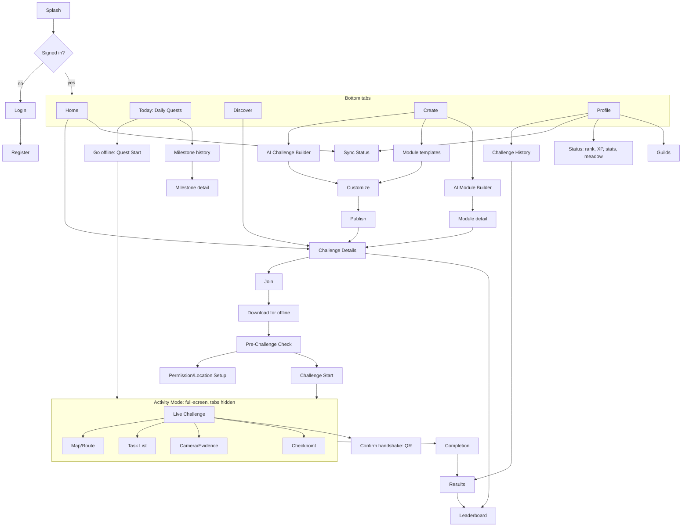

# UX: information architecture and screens

Design rule: **"Use the phone briefly, then put it away."** See [vision.md](vision.md#design-principles).

## Information architecture



**Global elements**
- A **Connectivity/Sync pill** sits in the header of every non-activity screen. Tapping it opens Sync Status.
- **Activity Mode** is a separate navigator. While a session is `in_progress`, the app always
  reopens into it, even after a crash or kill.

## Screens

Format: purpose · key elements · states/edge cases · primary action.

1. **Splash.** Open the DB, run migrations, read tokens from secure storage, and resume any active session (go straight to Live). Never block on the network.
2. **Login.** Email and password, "Forgot password" (SHOULD), link to Register. Offline: "You need internet to sign in the first time." A previously signed-in user can open the app offline.
3. **Registration.** Display name, email, password with strength hint, 16+ confirmation, privacy summary ("we never store your home address"). Inline zod validation.
4. **Home.** "What's next?" Next joined challenge card with countdown and an offline-ready badge; a "Continue" card if a session is unsynced; recent results; impact counter (trees watered, litter collected). Primary action: Start or Discover.
5. **Discover.** List-first with a map toggle. Filters: module, distance, duration, difficulty, team/solo. Nearby search uses **coarse location** (rounded to about 1 km on the client). Offline: cached and joined challenges plus "Discover needs internet".
6. **Challenge Details.** Hero (module icons, duration, distance, difficulty); rules rendered deterministically from the DSL plus an optional AI "Explain simply"; start zone map; checkpoints; tasks; evidence required; scoring table; participants and teams. Primary action: Join, which becomes Download once joined, then "Prepare to start".
7. **Create Challenge.** Two entry points: **"Describe it" (AI)** and **"Start from a module"** (templates). Drafts list.
8. **AI Challenge Builder.** Text input with example chips. A badge shows **where the model runs** ("On this device · Qwen3-1.7B" or "Trina server · open model"). Shows a structured preview card, not chat prose, and validator adjustments ("60 min is too short for 8 km walking. Reduced to 4 km."). Actions: Use draft, Try a variation, Easier/Harder. With no AI available, fall back to templates with an explanation.
9. **Customize Challenge.** Map editor (start zone, checkpoints, radii), task editor (module task types, params, evidence toggles), scoring preview, live **validator panel** (errors and warnings). Primary action: Publish.
10. **Join Challenge.** Sheet with team pick or create, rules acknowledgement, safety acknowledgement, and "Auto-download for offline" (on by default).
11. **Pre-Challenge Check.** Live checklist (see below). Blocking failures disable Start; warnings allow continuing. One-tap fixes.
12. **Permission/Location Setup.** Explain before asking. **While-in-use** location only (never "Always"); notification permission on Android (foreground service); **physical activity / motion** permission for step counting (optional). If denied, show settings deep link and instructions.
13. **Challenge Start.** "You're in the start zone ✓" with an accuracy indicator, an optional **mood check-in** (5 emojis, "How do you feel?", skippable), safety reminder, **slide-to-start**, 3-2-1 countdown with haptics, then a 5-second "Put your phone away" card.
14. **Live Challenge.** Minimal (see below).
15. **Map/Route.** MapLibre offline map: route line, numbered checkpoints, user dot with accuracy circle, boundary. No continuous camera-follow. A **Compass-only fallback** (bearing arrow plus distance) works without tiles.
16. **Task List.** Tasks with status: locked, available, in progress, done, pending verification. Evidence thumbnails. A checkpoint-bound task unlocks on reaching its checkpoint.
17. **Camera/Evidence.** In-app camera only for required evidence (no gallery). A framing hint per task ("Show the full bag of litter"). Preview, then Use or Retake. "Saved on device · will upload later".
18. **Checkpoint.** Triggered automatically by the geofence: haptic, sound, notification, then "Checkpoint 2 reached ✓" and unlocked tasks. Manual "I'm here" button when GPS is borderline, recorded as a low-confidence event that the server judges.
19. **Offline State.** A system-wide state rather than a screen: amber pill, banners on network-only screens, disabled server-only actions with reasons. In Activity Mode, show only a small icon and never nag.
20. **Sync Status.** Overall state, last sync time, groups (*Activity data*, *Photos*, *Other*) with counts, progress and per-item errors. Actions: Sync now, "Upload photos on mobile data" toggle, Copy diagnostics.
21. **Challenge Completion.** Triggered by a completion rule or manual Finish (with confirmation). Optional **mood check-in** ("How do you feel now?"). Shows the **provisional score** labelled "Offline · will verify when online", impact stats and a wellness card (steps, ~kcal, phone-free minutes).
22. **Results.** Final breakdown (checkpoints, tasks, bonuses, penalties). Verification status: Verified, Verified with notes, Under review, or Not verified, with human-readable reasons. **Wellness card**: steps, cadence, active and phone-free minutes, ~kcal (estimate), mood before → after, plus a short **AI recap** written from those numbers. Simplified route map. Evidence gallery.
23. **Leaderboard.** Individual and Team tabs. Rank, name, points, time, verification badge. "Pending review" listed separately. Cached copy offline with a timestamp. No locations.
24. **Profile.** Stats, impact and **wellness totals** (week/month: steps, active minutes, phone-free minutes, ~kcal, mood trend if opted in). Settings: optional **weight** (device-only, for calorie estimates), **"Share wellbeing data"** (default off), units, photos on mobile data, **AI model management** (download/delete, storage), privacy (export/delete), devices (sign out others), logout.
25. **Challenge History.** Past sessions with sync and verification status, linking to Results.

### Milestones, quests, custom modules and guilds (2026-10-11)

Design: [architecture/milestones-and-custom-modules.md](../architecture/milestones-and-custom-modules.md) §7.

26. **Home additions.** An auto-sliding **quote carousel** (60 original lines, daily order, pauses on touch, no auto-slide with
    "reduce motion") mixed with personal cards ("Today's quests: 1/3", "2 more 90-min days for the +15 bonus"), and a
    **Daily Quest card** with the week's **meadow** (a blade of grass per 10 offline minutes, flowers on 90-min days).
27. **Today** (tab). 3 Daily Quests with progress (works offline), the weekly "Offline 3 × 90" bonus and force-stop count,
    milestones in progress with verification badges, links to History and Status. Copy: "Resets at 4 am. Rest days are part of it."
28. **Quest Start (Go offline).** Length chips (30/45/60/90), pre-sync status, **"Turn off mobile data and Wi-Fi"** check
    (calls keep working), GPS-fix check, one-tap **Open internet settings** (Android panel; iOS Settings + Control Centre hint).
    **Start stays locked while online.** "Stopping for safety never costs points."
29. **Live (quest).** "OFFLINE QUEST · 30 MIN" card with minutes outside; an "📶 You're online" card with a 60-second grace;
    paused while online; **Stop quest** sheet with safety reasons (never penalised) or "I just want to stop".
30. **Live (data modules).** A **counter pad** (+1 / −1, "Self-reported (titles only)" or "Confirmed: n") and
    **Ask to confirm / Confirm a friend** buttons. Confirmation-only tasks show "Ask a teammate to confirm".
31. **Confirm handshake.** *Ask*: choose claims (counters pre-selected, tasks opt-in) → QR-A → scan their signed QR-B.
    *Confirm a friend*: scan QR-A → review, lower values with "−" (never raise) → "Confirm and sign" → QR-B. Fully offline.
32. **Completion additions.** "Quest complete! 🌱" with "turn the internet back on whenever you like"; **Unlocked** list with
    verification badges ("final check when synced"); safety stops read "Stopped for safety: no points lost".
33. **Status.** Rank letter, XP, rank-point bar to the next rank ("never goes down"), 5 stat bars (Vitality, Agility,
    Strength, Sense, Aura), meadow, today's XP vs the 300 cap, Share (rank and minutes only, no places or times).
34. **Milestone History / Detail.** Grouped by day, filter by verification; revoked ones struck through with neutral copy;
    the detail explains how it was verified and shows tiers and dates.
35. **AI Module Builder.** One text box + example chips → structured draft card (counters/tasks with verification badges,
    milestones, **safety notes**), name field, Save. Refusals show the reason; non-English input gets "English for now";
    offline: "Building a module needs the internet (playing never does)".
36. **Module Detail.** Status chips ("Community · by …", fork credit), Publish privately / Share by link (disabled for
    private-only risk), Play this now, Make my own version (fork), Report.
37. **Guilds.** My guilds with the weekly board and **Guild Quest** (600 offline minutes together), invite code, join by
    code, create; offline shows the last saved boards.

**Notifications:** "Milestone unlocked: Took a catch 🏏 · Confirmed by another player · Final check when you're back online"
once per unlock; "Confirmed: …" once when the server agrees; never during an active session; Android channel "Milestones".

## Offline and sync states (copy)

| State | Pill | Copy |
|---|---|---|
| Online, nothing pending | 🟢 | "Everything is synced." |
| Online, pending | 🔵 | "Ready to sync" |
| Offline | 🟠 | "You're offline. Your progress is safe on this device." |
| Syncing | 🔵 animated | "Syncing 12 activities…" / "Uploading 3 photos…" |
| Sync complete | 🟢 | "Everything is synced." (+ "Last synced 2 min ago") |
| Partial failure | 🟡 | "3 items couldn't sync. We'll retry automatically." |
| Waiting for Wi-Fi | ⚪ | "2 photos waiting for Wi-Fi." |
| Auth expired | 🟡 | "Sign in to sync. Your data is safe on this device." |
| Validating | 🔵 | "Synced. Verifying your results…" |
| Results ready | 🟢 | "Your results are in!" |

Never rely on colour alone: every state has an icon and text.

## Pre-flight check

| Check | How | Blocking? | Fix |
|---|---|---|---|
| Auth valid | Token present (an expired access token is fine offline) | Yes if never signed in | Sign in |
| Challenge downloaded | Bundle present, hash matches | **Yes** | Download |
| Engine compatible | `engineMinVersion ≤ app engine` | **Yes** | Update app |
| Route/checkpoints available | In definition | **Yes** | Re-download |
| Map pack | File present | No (compass fallback) | Download map |
| Location permission | While-in-use granted | **Yes** | Permission screen |
| Notifications (Android) | Granted | No (warn) | Settings |
| GPS accuracy | Best fix ≤ 50 m within 30 s | **Yes** | "Move to open sky" |
| In start zone | distance ≤ radius + min(acc, 25) | **Yes** | Navigate to start (compass) |
| Camera permission | If any task needs photos | **Yes** if needed | Permission screen |
| Activity recognition / motion | For steps | No (warn: "Steps won't be counted") | Permission screen |
| Storage | Free ≥ (photos × 1 MB) + 50 MB | **Yes** | Free space |
| Battery | ≥ 20 % | No (warn) | n/a |
| Battery optimization (Android OEMs) | Exempted? | No (warn) | Deep link |
| Challenge window | Now within window (clock offset from download) | **Yes** | n/a |
| Eligibility | Participation cached as joined, not withdrawn | **Yes** | Join |
| Clock sanity | Offset vs last server time within 5 min | No (warn) | Go online once |

## Live Challenge screen

```
┌──────────────────────────────┐
│ ⏱ 41:12 left        🟠 offline│
│                              │
│  NEXT: Checkpoint 3 · Old Oak │
│        ↗  320 m              │
│                              │
│  TASK: Water the tree 💧      │
│  (unlocks at checkpoint)      │
│                              │
│  ● ● ◐ ○   2/4 checkpoints   │
│  2.1 km · 2,840 steps · 140 pts│
│                              │
│ [📷 Evidence]  [🗺 Map] [☰ Tasks]│
│                              │
│   🔒 Lock phone & go          │
└──────────────────────────────┘
```

- The screen prioritizes current task, time left, distance, next checkpoint (bearing and distance), and simple progress.
- **Lock & go:** the Android foreground-service notification shows the same summary on the lock screen.
- Feedback uses haptics and sound on checkpoint entry, and optional TTS.
- Updates are throttled to once a second. No animations, dark background, minimal redraws to save battery.
- A "Finish" option is in an overflow menu with confirmation; Pause and Abandon are in the same menu.
