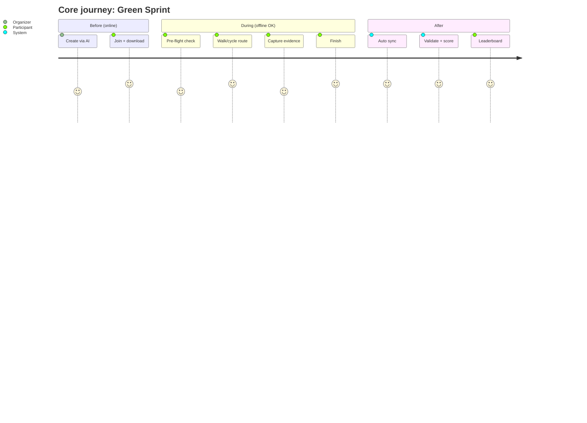

# Product vision

## Name

**Trina** (তৃণ) is Bengali for *grass*. It was built for the Hacktoberfest 2026 **"Touch Grass"** theme.

## Vision

> **Use the phone for two minutes, spend sixty outside.**

Trina turns outdoor time into small, social, verifiable challenges: a run, a cricket session, a
neighbourhood clean-up, watering roadside trees. The app sets up the activity, gets out of the
way while it happens, and fairly records what you did afterwards.

### Core beliefs

1. **Real-world activity is the product.** Screen time during a challenge counts as a cost, not as engagement.
2. **Offline is normal.** Parks, trails and riverbanks have bad signal, so the app never loses progress.
3. **AI is the creative assistant; rules are the referee.** A local open-weight model turns
   "let's cycle and clean up the park" into a challenge. Deterministic code decides who did it.
4. **Honest verification.** We flag suspicious activity and never claim perfect anti-cheat.
5. **Privacy by default.** We never need your home address, and raw GPS tracks expire.

## Personas

| Persona | Goal | Pain today | What they need from Trina |
|---|---|---|---|
| **Priya, the Organizer** (28, runs a weekend friends group) | Get 5 friends outside doing something different | Planning takes effort and polls die | AI builder: describe the idea, get a challenge, share a link |
| **Arjun, the Competitor** (22, runner/cyclist) | Beat friends on a fair leaderboard | Cheating erodes trust; big apps aren't social at small scale | Clear rules, validated scores, fast results |
| **Meera, the Civic Volunteer** (45, neighbourhood association) | Clean-ups and tree watering with proof of impact | Paper sign-ups, no impact record | Cleanup/tree modules, evidence photos, impact totals |
| **Sam, the Casual Walker** (35, low fitness) | A reason to go outside | Fitness apps feel intimidating | Short, easy challenges and gentle encouragement |
| **Admin/Moderator** | Keep the platform fair and safe | n/a | Flag queue, session review, takedowns |

## Core user journeys

- **J1. Create with AI (Priya):** Home → Create → AI Builder → types an idea → reviews the
  draft → adjusts pins and tasks in Customize → Publish → shares the link.
- **J2. Join and prepare (Arjun):** link → Challenge Details → Join (team) → **Download for offline** → "Ready offline ✓".
- **J3. Play offline (core):** start zone → Pre-flight → Start → phone in pocket → haptic at
  checkpoint → evidence photo → task done → … → Finish → **provisional score offline**.
- **J4. Sync and results:** connectivity returns → auto-sync (events, then photos) → server
  validation → final score → leaderboard → notification "Results are in".
- **J5. Discover (Sam):** Discover → filter "Nearby · Easy · <45 min" → Details → Join → J2.
- **J6. Moderate (Admin):** flag queue → session timeline, map and photos → Approve or Reject.

## Design principles

1. **Glance, don't scroll.** Every Activity Mode screen is readable in under 2 seconds at arm's length.
2. **Pocket-first feedback.** Haptics, sound, the lock-screen notification and optional TTS come before visual UI.
3. **Your progress is safe.** Every action is committed to SQLite before the UI confirms, and the UI says so.
4. **Outdoor legibility.** High contrast, ≥56dp touch targets, ≥18pt key text, readable in sunlight.
5. **AI suggests, rules decide.** AI output is always an editable draft; scores always come from the engine.
6. **Honest verification.** Show *why* something is flagged; never accuse.
7. **Privacy by default.** Coarse discovery location, no home location, track retention limits.
8. **Safety over score.** No speed bonuses on roads, daylight windows by default, a "phone down" nudge at cycling speeds.
9. **Works on mid-range phones.** AI is optional; everything else runs on a 4 GB RAM Android device.

## Assumptions

| # | Assumption |
|---|---|
| A1 | **Android first** for the MVP and demo; iOS supported by design with less testing. |
| A2 | React Native via **Expo dev builds** (native modules allowed). |
| A3 | Team of 2–4 developers, about 4 weeks (October 2026). |
| A4 | "Local open-weight AI" means on-device where feasible, otherwise self-hosted. No proprietary cloud LLMs. |
| A5 | Users are 16+ in the MVP. |
| A6 | OSM-based tiles from a legitimate provider or self-hosted PMTiles, never bulk-downloaded from tile.openstreetmap.org. |
